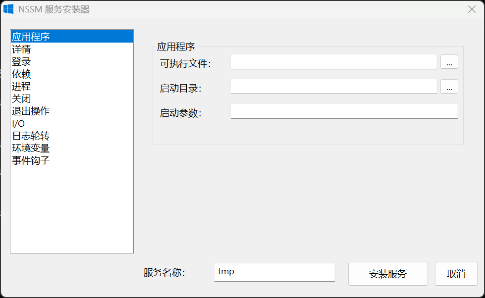

# NSSM (Non-Sucking Service Manager)

NSSM 是一个将任意可执行程序作为 Windows 服务运行并进行管理的工具，提供安装/编辑/移除、启动/停止/重启、I/O 重定向、环境变量与工作目录等能力。

## 兼容性说明
- 最低支持系统：Windows 10（`_WIN32_WINNT=0x0A00`）。
- 仅提供 x64 构建，不再支持 32 位 Windows。
- 交互式服务（`SERVICE_INTERACTIVE_PROCESS`，“与桌面交互”）在现代 Windows 中已不再作为可用能力，GUI 中已移除相关选项。



### 版本说明
本仓库基于 NSSM 原作（作者 Iain Patterson，上游网站：[nssm.cc](https://nssm.cc/)），遵循 Public Domain 许可。
在原版基础上主要进行了以下维护与增强：
- 版本信息升级到 `3.0.0`（`src/app/version.h`）。
- 最低系统基线升级为 Windows 10（`_WIN32_WINNT=0x0A00`），仅构建 x64。
- 清理并修复多处稳定性问题（句柄泄漏、内存释放一致性、边界/指针判断、注册表类型校验等）。
- 服务类型与现代 Windows 行为对齐：不再使用交互式服务类型，统一按 `SERVICE_WIN32_OWN_PROCESS` 处理。
- GUI 调整：移除现代 Windows 中无效的“与桌面交互”选项，避免误导。
- GUI 现代化：使用 Common Controls v6、Segoe UI 与 Per-Monitor DPI v2，采用左侧分类导航，并统一表单控件尺寸与高 DPI 间距。
- “描述”字段支持多行输入；CPU 亲和性列表按字体、CPU 编号和当前 DPI 动态计算列宽。
- 中文文案持续校对与统一（GUI 与 `messages.mc`），修复中英混杂和术语不一致问题。
- 构建链路迁移到 CMake、Ninja 和 MinGW-w64 GCC 14+，统一使用 C++20。
- Windows 消息与资源分别由 `windmc` 和 `windres` 编译，不依赖 Visual Studio。
- UTF-8 对话框资源在构建阶段转换为明确的 Unicode 转义，避免受 Windows 系统代码页影响。
- MinGW 运行库静态链接；Windows 系统库仍使用系统提供的 DLL。
- Release 链接不写入时间戳；相同源码和工具链可生成一致的二进制文件。

核心功能与命令行参数保持与原版兼容；如需原版发布与英文文档，请参见上游站点。

## 构建方式
### 1) 本地构建

不需要安装 Visual Studio。请准备以下 x64 UCRT 工具，且确保它们位于 `PATH`：

- MinGW-w64 GCC/G++ 14 或更高版本
- CMake 3.25 或更高版本
- Ninja
- GNU Binutils（必须包含 `windmc`、`windres` 和 `objdump`）

使用 MSYS2 时，可在 UCRT64 终端安装工具：

```sh
pacman -S --needed mingw-w64-ucrt-x86_64-gcc \
  mingw-w64-ucrt-x86_64-cmake \
  mingw-w64-ucrt-x86_64-ninja \
  mingw-w64-ucrt-x86_64-binutils
```

在 PowerShell 或 UCRT64 终端中构建并测试：

```powershell
cmake --preset mingw-debug
cmake --build --preset mingw-debug
ctest --preset mingw-debug

cmake --preset mingw-release
cmake --build --preset mingw-release
ctest --preset mingw-release
```

产物分别位于 `out\Debug\win64\nssm.exe` 和 `out\Release\win64\nssm.exe`。

版本输出默认使用稳定的 `release` 构建标签，不嵌入编译时间，以保证相同输入可生成可复现的二进制。需要区分内部构建时可在配置阶段传入 `-DNSSM_BUILD_LABEL=<标签>`。

本仓库开发环境还可将便携 MSYS2 放在被 Git 忽略的 `.tools\msys64`，然后在 PowerShell 中临时启用：

```powershell
$toolBin = (Resolve-Path '.tools\msys64\ucrt64\bin').Path
$env:PATH = "$toolBin;$env:PATH"
```

### 2) GitHub Actions

`.github/workflows/build.yml` 会在 push、pull request 或手动触发时，使用 MSYS2 UCRT64 分别构建和测试 Debug、Release。工作流还会验证产物是 x64 PE，并检查其没有动态依赖 `libgcc`、`libstdc++` 或 `libwinpthread`，最后上传 `nssm-win64-Debug` 和 `nssm-win64-Release` 工件。

## 构建与资源说明

- `CMakeLists.txt`：唯一受支持的构建入口；旧 VS2008 工程已删除。
- `CMakePresets.json`：提供 Debug、Release 和 RelWithDebInfo 预设。
- `cmake/CompileMessages.cmake`：调用 `windmc` 编译事件消息资源。
- `cmake/ConvertMessages.ps1`：把 UTF-8 消息源转换为 `windmc` 所需格式。
- `cmake/ConvertResource.ps1`：生成不依赖系统代码页的 Unicode 对话框资源。
- `cmake/VerifyResources.ps1`：检查编译后的 EXE 包含正确中文且不含常见乱码。
- `cmake/CompilerOptions.cmake`：集中维护 C++20、静态 MinGW 运行库及 PE 安全链接选项。

CTest 当前包含：

- `nssm.version`：验证版本、架构和程序可执行性。
- `nssm.validate`：验证声明式配置样例及 UTF-8/Unicode 解析。
- `nssm.resources`：验证中文资源的 UTF-16 内容并检测乱码回归。
- `nssm.unit`：覆盖命令行转义、环境隔离、Job Object、探针、恢复与配置校验。

## 项目结构

```text
src/
  app/          程序入口、全局编译契约与版本信息
  cli/          命令行和控制台适配
  config/       JSON 配置模型、校验及 SCM 应用
  supervisor/
    process/     进程创建、Job Object 与进程树终止
    monitoring/  Readiness、Health Check 与资源监控
    runtime/     服务状态机、恢复、Hooks、日志和账户
  platform/     Windows API、注册表、环境及编码适配
  ui/           旧 Win32 GUI（与核心运行时隔离）
resources/      RC、消息目录、图标和 manifest
tests/          单元测试及配置样例
cmake/          构建、资源转换和验证脚本
```

`CMakeLists.txt` 按相同职责分组列出源文件。新增功能应放入对应模块，避免再次把实现堆回仓库根目录。

提交代码前建议至少执行：

```powershell
cmake --preset mingw-release
cmake --build --preset mingw-release
ctest --preset mingw-release
```

## 图形界面说明

- 左侧分类导航用于切换应用程序、详情、登录、依赖、进程、关闭、退出操作、I/O、日志轮转、环境变量和事件钩子。
- 界面支持 Windows 10 高 DPI 缩放；CPU 亲和性列表会根据当前 DPI 自动调整列宽。
- 单行输入框与浏览按钮使用统一的行高和垂直中心线。
- “描述”、依赖和环境变量为多行输入；“描述”中可直接按 Enter 换行。
- 中英文对话框资源均以 Unicode 形式写入 EXE，不依赖“非 Unicode 程序的语言”等区域设置。

## 使用与命令（摘要）
参考官方命令行文档整理要点，详情见：[nssm commands](https://nssm.cc/commands)。

- 安装
  - GUI：`nssm install <ServiceName>`
  - 直接安装：`nssm install <ServiceName> <Program> [<Arguments>]`

- 编辑/导出/获取/设置/重置
  - GUI 编辑：`nssm edit <ServiceName>`
  - 导出当前配置：`nssm dump <ServiceName>`
  - 获取参数：`nssm get <ServiceName> <Parameter> [<Subparam>]`
  - 设置参数：`nssm set <ServiceName> <Parameter> [<Subparam>] <Value>`
  - 重置为默认：`nssm reset <ServiceName> <Parameter>`
  - 删除参数：`nssm unset <ServiceName> <Parameter> [<Subparam>]`

- 启动/停止/重启/状态
  - 启动：`nssm start <ServiceName>`
  - 停止：`nssm stop <ServiceName>`
  - 重启：`nssm restart <ServiceName>`
  - 状态：`nssm status <ServiceName>`
  - 状态码：`nssm statuscode <ServiceName>`
  - 控制：`nssm pause <ServiceName>` / `nssm continue <ServiceName>` / `nssm rotate <ServiceName>`（按需轮转需启用在线轮转）
  - 进程树：`nssm processes <ServiceName>`

- 账户与登录（Log on）
  - 本地系统账户：`nssm set <ServiceName> ObjectName LocalSystem`
  - 指定账户+密码：`nssm set <ServiceName> ObjectName <username> "<password>"`（空密码可用 `""`）

- 依赖（Dependencies）
  - 依赖服务：`nssm set <ServiceName> DependOnService <Name>`
  - 依赖组：`DependOnGroup`（查询时统一带 `+` 前缀）。

- 进程（优先级/亲和性/控制台）
  - 优先级：`nssm set <ServiceName> AppPriority NORMAL_PRIORITY_CLASS`
  - 允许控制台：`nssm set <ServiceName> AppNoConsole 0`
  - 亲和性：`nssm set <ServiceName> AppAffinity All`

- 关闭（Shutdown）
  - 停止方法与超时（毫秒）：
    - 跳过方法：`nssm set <ServiceName> AppStopMethodSkip 0`
    - Console/Window/Threads 超时：`nssm set <ServiceName> AppStopMethodConsole 1500`、`...Window 1500`、`...Threads 1500`

- 退出动作与节流（Exit actions）
  - 节流时间：`nssm set <ServiceName> AppThrottle 1500`
  - 默认退出动作：`nssm set <ServiceName> AppExit Default Restart`
  - 固定重启延时：`nssm set <ServiceName> AppRestartDelay 0`

- I/O 重定向
  - 输出/错误：
    ```cmd
    nssm set <ServiceName> AppStdout C:\path\service.log
    nssm set <ServiceName> AppStderr C:\path\service.log
    ```
  - 若要合并 stdout 与 stderr，两个值必须是完全相同的路径字符串。

- 日志轮转（File rotation）
  - 启用轮转：`nssm set <ServiceName> AppRotate 1`
  - 仅在重启时轮转（默认），或在线轮转：`nssm set <ServiceName> AppRotateOnline 0|1`
  - 限制条件：
    - 最小时间（秒）：`nssm set <ServiceName> AppRotateSeconds 86400`
    - 最小大小（字节/高位）：`nssm set <ServiceName> AppRotateBytes 1048576`、`AppRotateBytesHigh <hi>`
  - 按需轮转：`nssm rotate <ServiceName>`（等待下一行输出后生效）

- 环境变量（Environment）
  - 兼容 srvany 的替换式环境：`AppEnvironment`（REG_MULTI_SZ，KEY=VALUE，每行一项）
  - 追加环境：`AppEnvironmentExtra`（与默认环境合并）
  - 示例：`nssm set <ServiceName> AppEnvironmentExtra JAVA_HOME=C:\java`

- 获取/设置/重置
  - 获取：`nssm get <ServiceName> <Parameter> [<Subparam>]`
  - 设置：`nssm set <ServiceName> <Parameter> [<Subparam>] <Value>`（多余参数会以空格拼接）
  - 重置：`nssm reset <ServiceName> <Parameter> [<Subparam>]`

- 常用参数要点
  - 启动目录：`AppDirectory`；安装后可覆盖：`nssm set <ServiceName> AppDirectory <Path>`
  - 环境：`AppEnvironment`（替换）、`AppEnvironmentExtra`（追加）；`nssm get` 可带子参数只取指定变量
  - 退出动作：`AppExit` 需子参数（`Default` 或退出码），例如：`nssm get <ServiceName> AppExit Default`
  - 原生属性：
    - 依赖：`DependOnService` / `DependOnGroup`
    - 启动类型：`Start`（AUTO/DELAYED_AUTO/DEMAND/DISABLED）
    - 类型：`Type`（仅 `WIN32_OWN_PROCESS`；`INTERACTIVE_PROCESS` 不作为受支持配置）

- 其他命令
  - 列出所有 NSSM 管理的服务：`nssm list`
  - 显示版本信息：`nssm version` 或 `nssm -v`
  - 移除服务：
    - GUI：`nssm remove [<ServiceName>]`
    - 直接移除：`nssm remove <ServiceName> confirm`

## GUI 选项卡说明

### 应用程序
- 指定可执行文件路径、启动参数、工作目录。
- 常见项：`Application`、`Arguments`、`AppDirectory`。

### 详情
- 设置显示名称、描述、启动类型（自动/延迟自动/手动/禁用）。
- 常见项：`DisplayName`、`Description`、`Start`。

### 登录
- 设置服务运行账户与密码，或使用 `LocalSystem`/虚拟服务账户。
- 常见项：`ObjectName`（用户名与可选密码）。

### 依赖
- 配置服务或服务组依赖顺序，确保依赖先启动。
- 常见项：`DependOnService`、`DependOnGroup`（组名前需 `+`）。

### 进程
- 配置优先级、CPU 亲和性、控制台可用性等进程级选项。
- 常见项：`AppPriority`、`AppAffinity`、`AppNoConsole`。

### 关闭
- 设置优雅关闭方法与各阶段超时（Console/Window/Threads）。
- 常见项：`AppStopMethodSkip`、`AppStopMethodConsole/Window/Threads`（毫秒）。

### 退出操作
- 为默认或特定退出码配置操作：重启/忽略/退出（一次性模式）/假崩溃（遗留兼容）。
- 常见项：`AppExit Default Restart|Ignore|Exit`，以及针对码值的映射。
  - 说明：`假崩溃（遗留兼容）` 对应 `Suicide`，用于兼容历史恢复策略；在 Windows 10+ 仍可用，但通常不建议作为首选策略。

### I/O
- 作用：将服务进程的标准输出(stdout)与标准错误(stderr)写入到文件，便于排查问题。
- 常见项：`AppStdout`、`AppStderr`（两个路径完全相同即可合并 stdout 与 stderr）。
- 注意：若程序直接写文件，文件句柄会被占用，影响“在线轮转”（见下）。
- 示例：
  - 合并输出：
    - `nssm set MySvc AppStdout C:\logs\mysvc.log`
    - `nssm set MySvc AppStderr C:\logs\mysvc.log`
  - 分开输出：
    - `nssm set MySvc AppStdout C:\logs\mysvc.out.log`
    - `nssm set MySvc AppStderr C:\logs\mysvc.err.log`

### 日志轮转
- 作用：当日志过大或运行过久时切分归档，避免日志无限增长。
- 模式：
  - 离线轮转（默认）：仅在服务停止/重启时轮转（`AppRotate=1` 且 `AppRotateOnline=0`）。
  - 在线轮转：服务运行中也能轮转（`AppRotate=1` 且 `AppRotateOnline=1`，通过管道写日志）。
- 触发条件（可同时设定）：
  - 按时间：`AppRotateSeconds <seconds>`（达到最小时间阈值后可轮转）。
  - 按大小：`AppRotateBytes <bytes>` 和 `AppRotateBytesHigh <hi>`（支持 >4GB）。
- 按需轮转（手动触发）：`nssm rotate <ServiceName>`（需已启用在线轮转才会立即生效）。
- 常见项：`AppRotate`、`AppRotateOnline`、`AppRotateSeconds`、`AppRotateBytes`、`AppRotateBytesHigh`。
- 示例：
  - 离线轮转（每天、至少 10MB）：
    - `nssm set MySvc AppRotate 1`
    - `nssm set MySvc AppRotateOnline 0`
    - `nssm set MySvc AppRotateSeconds 86400`
    - `nssm set MySvc AppRotateBytes 10485760`
  - 在线轮转（运行中到 100MB 切分）：
    - `nssm set MySvc AppRotate 1`
    - `nssm set MySvc AppRotateOnline 1`
    - `nssm set MySvc AppRotateBytes 104857600`

### 环境变量
- 设置替换式环境或追加环境（与默认环境合并）。
- 常见项：`AppEnvironment`（替换，REG_MULTI_SZ），`AppEnvironmentExtra`（追加）。

### 事件钩子
- 在 start/stop/exit/power/rotate 的 pre/post/change/resume 阶段执行脚本或程序。
- 常见项：注册表下 per-event/action 的命令；GUI 提供逐项配置与测试。

## 模块概览

| 模块 | 文件 | 作用描述 |
|---|---|---|
| 配置与 SCM 应用 | `src/config/` | 严格 JSON 校验、配置加载、服务创建与更新。 |
| 服务监督核心 | `src/supervisor/` | 生命周期、Job Object、探针、恢复策略、资源治理、日志和 Hooks。 |
| Windows 平台适配 | `src/platform/` | 注册表、环境块、事件日志、动态 API 导入和 Unicode 转换。 |
| CLI 与入口 | `src/app/`, `src/cli/` | 命令分派、服务入口和控制台交互。 |
| 旧 GUI | `src/ui/` | 与核心隔离的 Win32 界面，便于后续独立移除。 |
| 资源与本地化 | `resources/` | RC、manifest、图标以及中英文事件消息目录。 |

### 头文件接口层（建议入口）
- 核心头文件位于 `src/app/`、`src/config/` 和 `src/supervisor/`；平台兼容接口位于 `src/platform/`。
- 作用：定义跨模块结构体、常量、注册表参数名与公共函数声明，是理解模块边界和调用关系的首选入口。

### 消息编译链路
- 文本来源：`resources/messages.mc`（中英文消息模板）。
- 构建产物：通过消息编译工具（`mc.exe`）与资源编译流程生成消息资源，最终由程序/事件日志加载使用。
- 说明：运行时不会直接读取 `.mc`，而是读取编译后的消息表资源。

### 测试与验证现状
- CTest 覆盖纯逻辑与本地 Win32 API 测试，不依赖外网。
- 真实 SCM 安装、启停和账户权限场景仍需在管理员环境执行集成测试。

